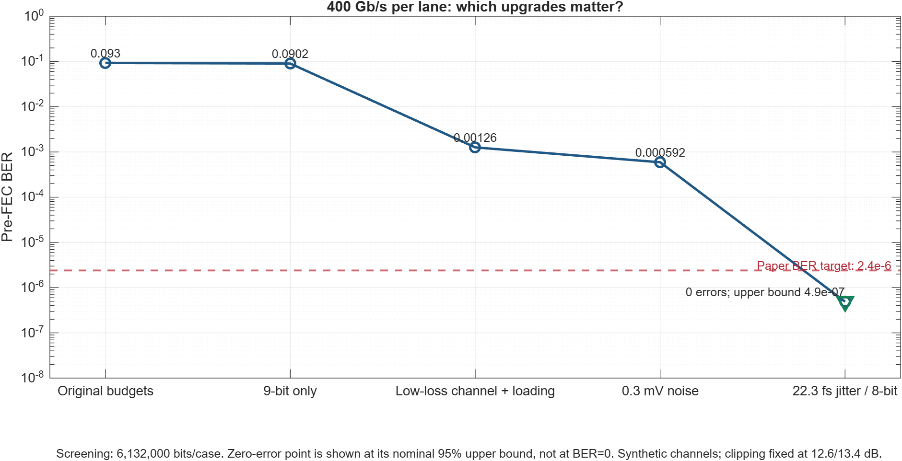
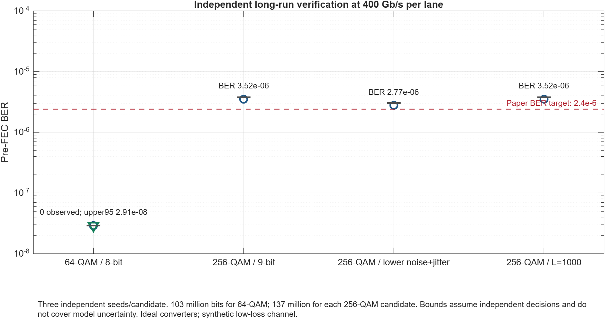

# 400 Gb/s per lane: verified model results and professor discussion

Simulation runs completed 8 October 2026 with the merged MATLAB code, MATLAB R2026b.
Documentation reviewed 10 October 2026. See [current validation](validation.md) for the concise result table and [project progress](project_progress.md) for what we changed.
The objective is behavioral feasibility and explicit circuit requirements.
Clipping is fixed at the paper's DAC/ADC values **12.6/13.4 dB** in every new case.
No transistor dimensions, PDK capabilities or silicon power/area are inferred
from the MATLAB BER alone. The paper's error targets are comparison targets;
the professor still needs to approve the project's BER/FEC/payload requirements.

## Main conclusion

**64-QAM supports a conditional 400 Gb/s/lane operating point in this model.**
An independently confirmed 8-bit ideal-converter candidate has zero observed
bit or symbol errors across three seeds and 103,017,600 bits. The nominal
one-sided 95% BER upper bound is 2.908e-8, below 2.4e-6. This is a conditional
model result, not zero true BER and not circuit verification.

**Keeping the original scalar budgets and simply raising the rate fails.**
At 400G with 64-QAM, the 7-bit/23 dB-at-40 GHz/1.8 mV/132.89 fs screening
case has BER 0.09297. Changing only to ideal 9-bit converters still gives
BER 0.09019. Channel, input-noise and absolute-jitter budgets matter together.

**256-QAM remains an alternative requiring further work.** Its smaller required
bandwidth is attractive, but none of the independently confirmed variants
establishes a reliable pass at both paper comparison targets in this study.
Per-lane and training-seed variation matters; an attractive screening seed
alone is insufficient.

## Verified configurations and results

All cases use FFT 1024, physical channel convolution, two lanes, no CTLE,
no FEC, unchanged 1.0/0.5 Vpp DAC/ADC full scales and mean-absolute clipping
interpretation. Noise is **before VGA**, avoiding the after-VGA assumption
used in the friend's 224G entry script. Main/FEXT symmetry and ideal converter
linearity remain assumptions. Synthetic channel cases retain the existing
parametric FEXT model; these are not measurements of a proposed interconnect.

| Independent candidate | Actual gross rate/lane | Fs / Nyquist | Ideal bits DAC/ADC | Pooled BER | Pooled SER | Comparison targets |
|---|---:|---:|---:|---:|---:|---|
| 64-QAM, L200 | 400 Gbps | 134.638 GS/s / 67.319 GHz | 8/8 | 0 observed, upper95 2.908e-8 | 0 observed, upper95 1.745e-7 | Conditional model pass |
| 256-QAM, L200 | 400 Gbps | 100.978 GS/s / 50.489 GHz | 9/9 | 3.524e-6 | 2.819e-5 | Fail |
| 256-QAM, lower noise/jitter | 400 Gbps | 100.978 GS/s / 50.489 GHz | 9/9 | 2.774e-6 | 2.219e-5 | Fail |
| 256-QAM, L1000 | 400 Gbps | 100.978 GS/s / 50.489 GHz | 9/9 | 3.516e-6 | 2.790e-5 | Fail |

Each row has three independent long runs. 64-QAM tests 103,017,600 bits;
each 256-QAM row tests 137,356,800 bits. Nominal bounds assume independent
Bernoulli decisions; correlated OFDM decisions and shared training estimates
can violate that assumption. Repeated seeds provide robustness evidence,
not a bound on physical model error. The 64-QAM nominal SER bound likewise
conditions on independent decisions.

The nominal bounds pass is verified for the pooled, symmetric two-lane model.
Every 64-QAM confirmation seed has zero errors on each individual lane.
Each lane alone has 51,508,800 tested bits and nominal BER upper95 5.816e-8.
For the standard 256-QAM candidate, the worst individual confirmation
lane/seed BER is 6.814e-6, exceeding the pooled BER and the comparison target.





## What has to change for the 64-QAM candidate

| Requirement | Paper/current 224G scalar starting point | Tested 400G candidate |
|---|---:|---:|
| Sampling rate | 75.25 GS/s | 134.638 GS/s |
| Required Nyquist coverage | 37.625 GHz | 67.319 GHz |
| Ideal converter codes | 7 bits | 8 bits |
| Synthetic main-channel loss at 40 GHz | 23 dB | 5 dB |
| Input-referred RX noise | 1.8 mV RMS | 0.3 mV RMS |
| RMS jitter per TX/RX timing process | 132.89 fs under UI=1/Fs interpretation | 22.282 fs |
| TX loading, first to last tone | -10.5 to 0 dB | -3.5 to 0 dB |
| DAC/ADC clipping | 12.6/13.4 dB | **12.6/13.4 dB** |
| CHEST averaging | L200 | L200 |

These are a demonstrated combination of **assumed requirements**, not unique
minimum specifications. One-dimensional screening also tests 0.5 mV noise,
10 dB-at-40 GHz channel loss with matched loading, and 50 fs jitter. Those
screening cases pass in short runs but have not received independent long
confirmation, and the individual margins must not be combined without a run.
Seven-bit screening is marginal: BER 2.446e-6 / SER 1.468e-5, slightly above
the comparison targets. The experiment does not determine required real ENOB.

The synthetic full frequency response, not merely its 5 dB loss anchor,
determines performance. Low channel loss implies a changed reach, material,
package/connector path or other interconnect improvement. A smaller CMOS
process alone does not change PCB/channel attenuation.

## 256-QAM investigation

Standard 256-QAM budgets are 9 ideal bits, 5 dB-at-40 GHz synthetic channel,
0.3 mV before-VGA noise, 22.282 fs jitter and -3.5 to 0 dB loading.
The lower-noise/jitter variant uses 0.1 mV and 10 fs. L1000 retains the
standard budgets and uses different independent confirmation seeds.

A matched-seed CP sweep at 8/16/32/64 samples solves Fs again to preserve
400 Gbps: 100.978/101.761/103.327/106.458 GS/s. It shows no consistent
screening improvement. A screening CP8 run passed, but its three subsequent
independent confirmations gave pooled BER 6.938e-6 / SER 5.539e-5.
Longer CP candidates were not independently confirmed. This demonstrates
training-seed sensitivity and does not establish CP as the limiting cause.

Reducing jitter/noise, changing ideal resolution to 10 bits, or increasing
CHEST L cannot be presented as proven solutions for 256-QAM from these tests.
The next useful diagnostic is per-tone training bias and clipping/nonlinearity
under the paper's fixed ratios, followed by a validated estimator/AFE model.
L1000 also uses a 27.4 microsecond batch startup, versus about 5.5 microseconds
for L200 at this sampling rate; latency and tracking must be budgeted.

A measured IEEE Bch2_7 THRU/FEXT1 sensitivity run covers the required
256-QAM band and gives BER 0.02814 under its tested settings. It is a negative
example, not an identified paper channel and not a fair standalone comparison
of measured versus synthetic channels because its loading is -10.5 to 0 dB.
The friend's Channel1 archive stops at 50 GHz, below even 256-QAM's 50.489 GHz
requirement; Bch2_7 stops at 67 GHz, below 64-QAM's 67.319 GHz requirement.
Therefore neither file pair supplies a fully measured 64-QAM 400G validation.

## Gross versus payload rate

The model uses the exact rate equation:

`R = 511 * log2(QAM) * Fs / (1024 + N_CP)`.

400 Gbps is the data framing rate before actual pilot scheduling and FEC.
Two training symbols after each M=200 data symbols give a data duty of
200/202 and 396.04 Gbps before FEC. That periodic schedule is an overhead
budget, not a tracking loop implemented in the current static-channel run.
With an illustrative FEC code rate
0.94, the payload is 372.277 Gbps. This code rate is a discussion example,
not a selected code. To deliver 400 Gbps payload, required Fs would become
144.664 GS/s for 64-QAM or 108.498 GS/s for 256-QAM with that schedule/code.
The higher payload-rate configurations must be separately simulated;
the verified 400G-gross result cannot be copied onto them.

## Smaller transistor processes: evidence and gaps

The workspace contains no PDK models, standard-cell timing libraries,
analog transistor circuit designs or extracted layouts. No process node
can currently be approved by this MATLAB simulation alone.

- [Imec, ISSCC 2026](https://www.imec-int.com/en/press/imec-unveils-7-bit-175gss-massively-time-interleaved-slope-adc-pairing-record-small-footprint)
  reports a 7-bit, 175-GS/s massively time-interleaved slope ADC in 5-nm FinFET,
  with a 250 x 250 micrometre core and 2.2 pJ/sample. It demonstrates that
  relevant sampling speed is physically possible. The release does not
  establish the ENOB/SNDR, aperture jitter, input swing and full-band accuracy
  needed to qualify our ideal 8-bit candidate. Its core area/energy are ADC
  reference values, not predictions for our complete transceiver.
- [Kim et al., synthesizable converter study](https://arxiv.org/abs/2009.09077)
  reports an 8-bit, 20-GS/s design in 16 nm with 5.6 ENOB. This illustrates
  why nominal bits cannot be substituted for real converter accuracy. It
  does not establish the maximum capability of the entire 16-nm process.
- [IBM, ISSCC 2025 DMT receiver](https://research.ibm.com/publications/a-353mw-112gbs-discrete-multitone-wireline-receiver-datapath-with-time-based-adc-in-5nm-finfet)
  supplies a relevant 112-Gb/s multitone architecture reference in 5 nm,
  rather than evidence that our 400G architecture has already been built.

For each candidate process, request ADC/DAC SNDR/ENOB versus frequency and
rate, aperture/clock jitter in fs, bandwidth, input/output swing, AFE noise,
nonlinearity, interleaving gain/offset/skew mismatch and calibration behavior.
Import these data as behavioral impairments, then repeat the counted BER runs.
Use transistor simulation/PDK corners to characterize the analog blocks and
RTL synthesis with the real cell library to assess the digital design.

At Fs=134.638 GS/s, a 64-sample-wide DSP path requires a nominal 2.104 GHz
sample-processing clock; a 128-wide path requires 1.052 GHz. These are
throughput arithmetic, not an FFT schedule or timing closure result.
Time-interleaving similarly reduces each converter slice's conversion rate,
but does not eliminate the common input bandwidth or skew-calibration burden.
Keep power/area/latency and supply-compatible 1.0/0.5 Vpp swings as explicit
requirements, rather than assuming unchanged swings in a smaller process.

## What to ask the professor to approve

1. Confirm **400 Gbps per lane**, and decide gross versus delivered payload.
2. Approve a BER/SER acceptance criterion and an actual FEC code/rate.
3. Approve **64-QAM as the first circuit-feasibility candidate**, retaining
   256-QAM as a lower-bandwidth research alternative.
4. Decide whether low-loss reach/material/package changes are allowed;
   obtain complex THRU/FEXT data covering at least 67.319 GHz plus margin.
5. Obtain candidate-process converter/AFE/clock data and the available PDK.
   Compare measured budgets with the candidate requirements, including DSP
   precision, interleaving, PVT and power/area/latency.

Suggested statement: **"Our current MATLAB model verifies a conditional
400-Gb/s/lane 64-QAM operating point with fixed paper clipping. We have
identified the channel, converter, noise and clock requirements. The next
phase is to verify those requirements against actual circuit/process data."**

## Reproduction and evidence

From the project root:

```matlab
run_400G_verification
run_400G_cp_verification
run_400G_training_verification
plot_400G_verification
```

Run scripts sequentially. Results/configs/seeds/counts/logs are under
`results/400G_verification/`. Screening is 17 budget/channel cases plus three
jitter sensitivity checks; three primary candidates have nine long runs,
with three additional CP confirmations and three additional L1000 confirmations.
`validate_phase1` passes actual-rate arithmetic, QAM/OFDM recovery, stable
shared gains, independent jitter and CHEST algebra. This is functional
verification; it does not validate each impairment model against a circuit.
