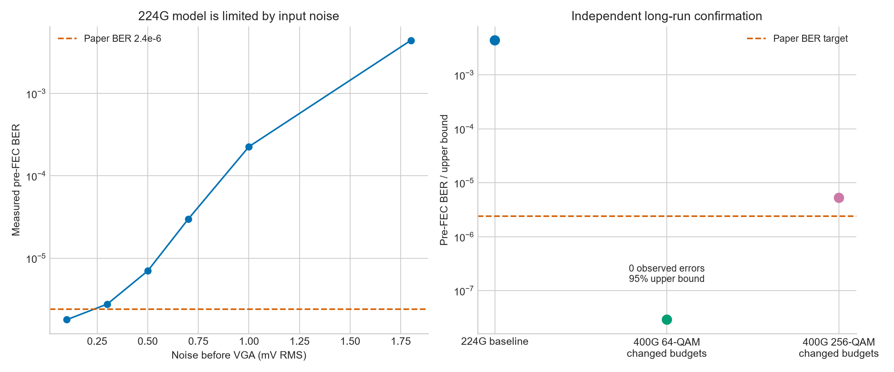
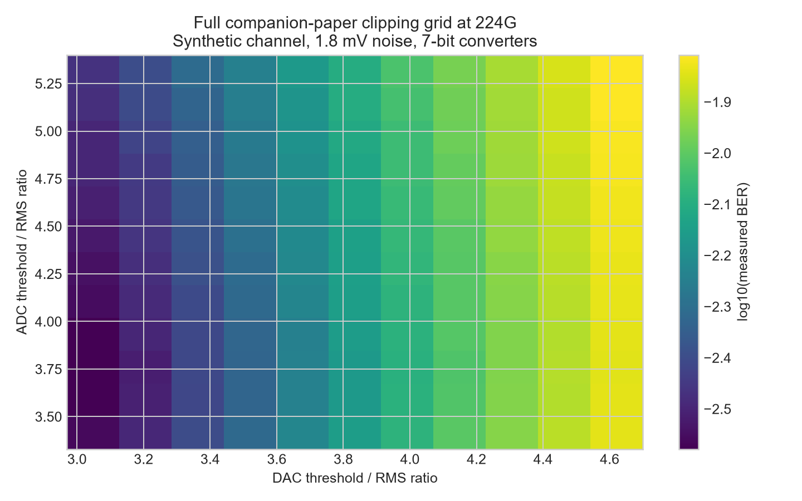

# Phase-one MATLAB findings - 7 October 2026

> Status, 10 October 2026: this document retains earlier experiments and assumptions. Use [current validation](validation.md), [project progress](project_progress.md), and [400G verification](400G_verification_for_doctor.md) for the latest confirmed numbers.

The 224G framing runs correctly, but the complete error-rate headline is **not
reproduced** with the stated 1.8 mV input noise and the available channel model.
A conditional 400G behavioral candidate achieves zero observed bit errors in
103,017,600 tested bits after changing the physical budgets. This does not
demonstrate a 400G circuit or identify the paper's channel.

## What was run

MATLAB R2026b, locally installed, was used for every reported communication
simulation. Python only converts public channel data and builds this report.
Old result files were preserved; current results live in `results/phase1/`.

- Ten 224G impairment/interpretation/training cases.
- Eighty-one rate-correct 400G architecture/channel/converter/power-loading points.
- Six 224G noise budgets, two public measured-THRU sensitivity cases,
  and sixty-four 400G changed-budget points.
- The complete DSE Fig.25 11x12 clipping grid at the 1024-FFT design point.
- Twelve 400G converter/jitter-model robustness cases.
- Independent long confirmation of the 224G baseline and two 400G paths.
- `validate_phase1` passed the rate, QAM/OFDM, gain sharing, independent jitter
  and CHEST algebra checks. Console logs and MATLAB configuration structs are retained.

## Corrected errors and ambiguities

1. Restored the FEXT paper's clipping numbers. Its "average magnitude" is
   distinct from DSE's RMS reference. Literal mean-absolute interpretation
   gives RMS ratios ~3.404/3.732; both interpretations were run.
2. Calibrated a single DAC scale and VGA gain for both pilots and data. Removed
   the arbitrary fixed VGA=2 baseline setting. Gains are ideal ensemble calibrations.
3. Made TX/RX jitter independent across lanes, data runs and training. The old
   implementation repeatedly seeded the same jitter vectors.
4. Used pilots with equal real and imaginary magnitudes, retaining the two-symbol
   opposite/same-polarity protocol. Pilot phases vary by cycle; fixed pilots
   were also tested because the exact paper sequence is unspecified.
5. Preserved channel memory across batched training symbols and averaged each
   cycle's inverse coefficients P as FEXT Fig.7 describes.
6. Passed the chosen noise/SNR settings consistently through training and data.
7. Solved the exact gross-rate equation for each 400G modulation/FFT/CP choice.
   Previously changing QAM could change actual throughput while retaining a 400G label.
8. Added public measured-complex/magnitude THRU imports with a bandwidth guard.
   The candidate is not the identified paper channel, and its FEXT remains synthetic.

## Measurements

| Case | BER | SER | Meaning |
|---|---:|---:|---|
| Paper headline | 2.4e-6 | 1.4e-5 | Published architectural simulation reference |
| 224G corrected baseline, pooled independent seeds | 0.00437007 | 0.0256361 | All stated scalar impairments, synthetic channel, literal clipping interpretation |
| 400G 64-QAM / ideal 9-bit, changed budgets | 0 observed | 0 observed | Nominal one-sided 95% BER upper bound 2.91e-08; conditional model |
| 400G 256-QAM / ideal 9-bit, spectral jitter | 5.27094e-06 | 4.21676e-05 | Lower bandwidth; misses the paper's BER headline |

The long 224G baseline tested 103,017,600 bits total across two lanes
(51,508,800 per lane), observing 450,194 bit errors. Its nominal
pooled 95% Wilson BER interval is [0.00435735, 0.00438283].
It is 1821 times worse than the paper BER.

The 256-QAM confirmation tested 137,356,800 bits, observing 724
errors; nominal Wilson interval [4.90072e-06, 5.66913e-06]. Error counts vary by
independent training/data seed; the screening result was more optimistic.
These intervals condition on independent Bernoulli decisions and a fixed
behavioral model. OFDM/training errors can be correlated; these bounds do not
cover channel/model uncertainty or silicon variation. Per-seed CSVs are supplied.

The baseline's actual framing rate is **223.5625 Gb/s/lane**, using 511 tones,
6 bits/tone, Fs=75.25 GS/s and 1032 samples/OFDM symbol. The paper rounds it to
224 Gb/s. This is a throughput statement, separate from error-rate success.

## Why further numerical tuning does not prove paper reproduction

The thermal-noise ablation yields BER 1.63e-6 / SER 9.78e-6 in screening,
but removing the specified 1.8 mV noise violates the baseline. Moving noise to
the ADC input improves BER to 9.65e-5 but still misses the headline and uses a
different noise-reference assumption. L1000, negligible quantization error,
zero jitter and CP64 ablations do not close the all-impairment gap.

Even the best full clipping-grid screening point gives BER 0.00264025,
at TX RMS ratio 2.97 and RX RMS ratio
3.518. This changes clipping settings and still misses
the headline by orders of magnitude. It is not a new paper baseline.

With the baseline channel and converter settings, measured noise-budget runs
approach the paper BER only around a few tenths of a millivolt or below.
Those reduced-noise cases are requirements experiments, not reproduction.
The real-channel candidate worsens BER: ~0.0102 with measured magnitude and
~0.0127 with complex phase. It cannot be selected as the author's exact channel
merely because its loss at 40 GHz is close.

## Conditional 400G requirements and limits

The confirmed zero-error 64-QAM path requires Fs=134.638 GS/s, band-edge
67.319 GHz, ideal 9-bit DAC/ADC, a changed synthetic 5 dB-at-40GHz channel,
0.3 mV noise before VGA, 0.3% UI jitter, -3.5 dB to 0 dB loading, and L200.
Full scales and clipping references stay as in the corrected baseline.
Eight-bit screening also gave zero errors in a shorter test; it is not yet
long-run validated. The 256-QAM path needs Fs=100.978 GS/s and 50.489 GHz,
with the same changed budgets and ideal 9-bit converters. Its longer results
are above 2.4e-6 BER but below the paper's illustrative 1e-4 design threshold.
No agreed project acceptance criterion or post-FEC result is assumed.

Neither candidate is validated on the proposed implementation channel or with
measured converter ENOB/SNDR, AFE bandwidth/linearity, clock phase noise,
fixed-point DSP, interleaving mismatch, acquisition or PVT. The 64-QAM band
edge also exceeds the downloaded measured candidate's 67 GHz coverage;
synthetic extrapolation is explicitly not measured evidence.

Pilot and FEC overhead must be budgeted to distinguish 400G gross from payload.
See `400G_approval_plan.md` for the decision package and acceptance gates, and
`paper_coverage.md` for the complete disclosed-detail ledger and missing data.

## Reproduce these results

```matlab
validate_phase1
run_phase1_audit
run_phase1_requirements
run_phase1_clipping
run_phase1_robustness
```

Run `analysis/build_phase1_report.py` using Python with matplotlib after the
MATLAB scripts. Configurations and trials are saved next to the CSVs. The
measured-channel conversion is documented in `paper_coverage.md`.




